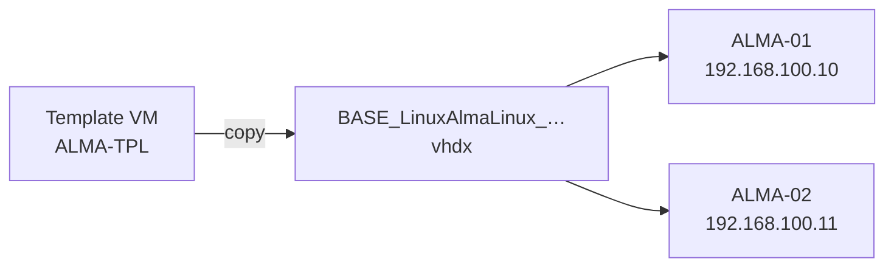

# Linux bases

HV-LAB clones Linux VMs the same way as Windows ones:

1. you prepare one **template VM** by hand;
2. HV-LAB copies its disk into a **base image**;
3. HV-LAB creates **clones** on differencing disks of that base.

Each clone gets its own host name, user, password and network on first boot, through [cloud-init](https://cloud-init.io).



## 1. Prepare the template VM

Create a VM in Hyper-V and install the distribution, for example AlmaLinux. The VM needs:

- **Generation 2**, with Secure Boot either set to the **Microsoft UEFI Certificate Authority** template or turned off;
- **a single disk** and **no checkpoint**;
- any name you like, for example `ALMA-TPL`.

Configure it as every clone should be: packages, updates, settings. Then, in the VM:

=== "AlmaLinux / Rocky / RHEL"

    ```bash
    sudo dnf install -y cloud-init hyperv-daemons
    sudo cloud-init clean --logs --machine-id
    sudo poweroff
    ```

=== "Debian / Ubuntu"

    ```bash
    sudo apt install -y cloud-init      # already installed on Ubuntu Server
    sudo cloud-init clean --logs --machine-id
    sudo poweroff
    ```

What these commands do:

- **cloud-init** applies each clone's settings on its first boot;
- **hyperv-daemons** reports the VM's IP address to Hyper-V;
- `cloud-init clean --machine-id` resets the machine ID and the cloud-init state.

Each clone then starts as a new machine, with its own machine ID and SSH host keys.

!!! warning
    Without this preparation, every clone keeps the template's host name and machine ID. Clones with the same machine ID also get the same DHCP address.

## 2. Create the base

In **Base VHDX Images**, open **Create a base from an existing VM**:

| Field | Example |
|---|---|
| Source VM (stopped) | `ALMA-TPL` |
| Family | Linux |
| Distribution / name | `AlmaLinux` |
| Version | `9.6` |

Click **Create the base from the VM**. HV-LAB checks that the VM is stopped, has no checkpoint and has a single disk. It then:

1. copies the disk into a standalone dynamic VHDX, `BASE_LinuxAlmaLinux_9.6.0.0_40.vhdx`, where 40 is the disk size in GB;
2. writes a `BASE_…json` file next to it, with the VM's generation and Secure Boot settings, which the clones reuse.

**The template VM is not modified.** Keep it to update it later and make a new base.

!!! tip "Windows too"
    The same function turns a customized Windows VM into a base. Generalize it first:

    ```powershell
    C:\Windows\System32\Sysprep\sysprep.exe /generalize /oobe /shutdown
    ```

## 3. Create the clones

In **Create VM**, choose the Linux base. The **Answer file** section becomes **cloud-init configuration (Linux)**:

| Field | Notes |
|---|---|
| Computer name | Becomes the host name, in lowercase. In bulk mode, each clone gets its own name. |
| User (sudo) | `labadmin` by default. It can run every command with `sudo`. |
| User password | **Required**. SSH password logon is enabled. |
| SSH public key | Optional, for example `ssh-ed25519 AAAA… user@host`. |
| Language | Sets the console keyboard layout: `fr`, `us`, `gb`, `de`, `es` or `it`. |
| Time zone | Converted to its Linux name, for example `Romance Standard Time` → `Europe/Paris`. |
| Static IP address | Off by default: the clone uses DHCP. Turned on, it asks for the 1st VM's address, the prefix, the gateway and the DNS servers. |

In bulk mode, the address goes up by one for each clone: `ALMA-01` gets `192.168.100.10`, `ALMA-02` gets `192.168.100.11`, and so on.

!!! info "NAT networks"
    The [NAT networks](networking.md#nat-networks) of HV-LAB have no DHCP. Use a static IP, with the NAT gateway as the gateway.

### What happens on creation

1. The differencing disk is created on the base.
2. A 64 MB disk, `<VM>-cidata.vhdx`, is created next to it, with a FAT volume labelled `CIDATA` that holds:
    - `meta-data`: a unique instance ID and the host name;
    - `user-data`: the user, its password, the SSH key, the time zone and the keyboard;
    - `network-config`: the static IP, when one is set.
3. The clone keeps the template VM's generation and Secure Boot template.
4. Its [Hyper-V notes](create-vm.md#vm-notes) hold the creation date, the user, its password and the IP.

On first boot, cloud-init reads the `CIDATA` disk and applies the settings. Then log on:

```bash
ssh labadmin@192.168.100.10
```

!!! note "Network interface"
    The static IP is set on `eth0`, the name the Hyper-V network adapter gets on most distributions.

!!! warning "Lab use"
    The password is stored in clear text on the `CIDATA` disk and in the VM notes.

## Quick VM

**Quick VM** can also create a differencing VM on a Linux base. The clone keeps the base's Secure Boot template, but it gets no cloud-init settings, so it keeps the template's host name.

## Troubleshooting

The clone does not get its settings
:   Check in the template VM that cloud-init is installed and that `cloud-init clean` was run before the shutdown. In the clone, these show what happened:

    ```bash
    sudo cloud-init status --long
    sudo less /var/log/cloud-init.log
    ```

The clone does not boot: "Secure Boot violation"
:   The template VM was not using the Microsoft UEFI Certificate Authority template. Change it on the template, then make the base again.

"The VM must have a single system disk"
:   Detach any data disk from the template VM, or copy what it holds onto the system disk.
