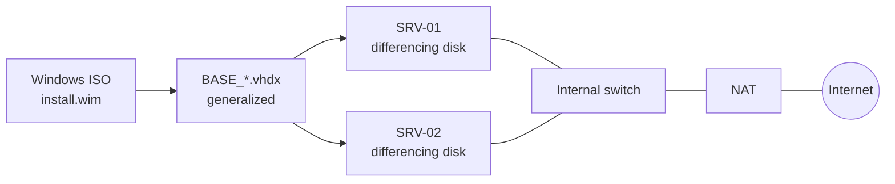

# HV-LAB Manager

HV-LAB Manager is a Windows desktop application for building and running Microsoft Hyper-V labs:

- base images;
- virtual machines on differencing disks, with an unattended setup;
- virtual switches and NAT.

It is a WinUI 3 / .NET 10 application and needs nothing else on the computer. It drives Hyper-V through Windows PowerShell, so everything it creates also shows in Hyper-V Manager.

[Download the latest release](https://github.com/JM2K69/HV-LAB/releases/latest){ .md-button .md-button--primary }
[Installation](install.md){ .md-button }

## Features

-   **Base images**

    ---

    Build a `BASE_*.vhdx` from the `install.wim` or `install.esd` file of a Windows ISO:

    - the edition, OS family and WIM index are detected for you;
    - the build runs silently, with no drive letter and no Explorer window;
    - the image stays generalized.

    [:octicons-arrow-right-24: Base images](guide/base-images.md)

-   **Unattended VMs**

    ---

    Create a VM on a differencing disk with an injected `unattend.xml`:

    - computer name and Administrator password;
    - language, time zone and KMS key;
    - optional auto-logon.

    Bulk mode creates `SRV-01…nn` in one go.

    [:octicons-arrow-right-24: Create a VM](guide/create-vm.md)

-   **Quick VM**

    ---

    Size profiles from XXS to XL, a blank or differencing disk, Generation 1 or 2, Secure Boot and PXE boot.

    [:octicons-arrow-right-24: Quick VM](guide/quick-vm.md)

-   **Switches & NAT**

    ---

    External, Internal and Private switches with an optional VLAN. NAT networks give the VMs of an internal switch access to the Internet.

    [:octicons-arrow-right-24: Switches & NAT](guide/networking.md)

The interface follows Fluent design:

- Mica backdrop and a light or dark theme;
- French or English, switchable live;
- keyboard shortcuts: ++f5++ refreshes and ++del++ deletes the selection.

Every long operation can be cancelled, and every input is validated before it reaches PowerShell.

## Recommended workflow

The dashboard suggests the same four steps:

1. [Create an internal switch](guide/networking.md#create-a-switch).
2. [Configure NAT on that switch](guide/networking.md#nat-networks) so the VMs can reach the Internet.
3. [Build a base image](guide/base-images.md) from a Windows ISO.
4. [Create VMs](guide/create-vm.md) on differencing disks of that base image.

Each VM only stores its own changes, so a new VM takes a few seconds and a few megabytes.

## Requirements

- Windows 10/11 Pro, Enterprise or Education, or Windows Server, with Hyper-V.
- An administrator account: the application runs elevated.

See [Installation](install.md) for details.
