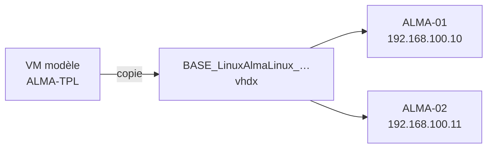

# Bases Linux

HV-LAB clone les VM Linux comme les VM Windows :

1. vous préparez une **VM modèle** à la main ;
2. HV-LAB copie son disque en **image de base** ;
3. HV-LAB crée des **clones** en disques différentiels sur cette base.

Chaque clone reçoit au premier démarrage son nom d'hôte, son utilisateur, son mot de passe et son réseau, grâce à [cloud-init](https://cloud-init.io).



## 1. Préparer la VM modèle

Créez une VM dans Hyper-V et installez la distribution, par exemple AlmaLinux. La VM doit être :

- en **génération 2**, avec Secure Boot sur le modèle **Microsoft UEFI Certificate Authority**, ou désactivé ;
- avec **un seul disque** et **aucun point de contrôle** ;
- nommée comme vous voulez, par exemple `ALMA-TPL`.

Configurez-la comme tous les clones devront l'être : paquets, mises à jour, réglages. Puis, dans la VM :

=== "AlmaLinux / Rocky / RHEL"

    ```bash
    sudo dnf install -y cloud-init hyperv-daemons
    sudo cloud-init clean --logs --machine-id
    sudo poweroff
    ```

=== "Debian / Ubuntu"

    ```bash
    sudo apt install -y cloud-init      # déjà présent sur Ubuntu Server
    sudo cloud-init clean --logs --machine-id
    sudo poweroff
    ```

Ce que font ces commandes :

- **cloud-init** applique les réglages de chaque clone à son premier démarrage ;
- **hyperv-daemons** remonte l'adresse IP de la VM à Hyper-V ;
- `cloud-init clean --machine-id` réinitialise l'identifiant machine et l'état de cloud-init.

Chaque clone démarre alors comme une nouvelle machine, avec son propre identifiant machine et ses propres clés d'hôte SSH.

!!! warning
    Sans cette préparation, tous les clones gardent le nom d'hôte et l'identifiant machine du modèle. Des clones avec le même identifiant machine reçoivent aussi la même adresse DHCP.

## 2. Créer la base

Dans **Images de base VHDX**, ouvrez **Créer une base depuis une VM existante** :

| Champ | Exemple |
|---|---|
| VM source (arrêtée) | `ALMA-TPL` |
| Famille | Linux |
| Distribution / nom | `AlmaLinux` |
| Version | `9.6` |

Cliquez sur **Créer la base depuis la VM**. HV-LAB vérifie que la VM est arrêtée, sans point de contrôle et avec un seul disque. Ensuite :

1. il copie le disque en un VHDX dynamique autonome, `BASE_LinuxAlmaLinux_9.6.0.0_40.vhdx`, où 40 est la taille du disque en Go ;
2. il écrit à côté un fichier `BASE_…json` avec la génération et les réglages Secure Boot de la VM, que les clones reprennent.

**La VM modèle n'est pas modifiée.** Gardez-la pour la mettre à jour plus tard et refaire une base.

!!! tip "Pour Windows aussi"
    La même fonction transforme une VM Windows personnalisée en base. Généralisez-la d'abord :

    ```powershell
    C:\Windows\System32\Sysprep\sysprep.exe /generalize /oobe /shutdown
    ```

## 3. Créer les clones

Dans **Créer une VM**, choisissez la base Linux. La section **Fichier de réponse** devient **Configuration cloud-init (Linux)** :

| Champ | Remarques |
|---|---|
| Nom de l'ordinateur | Devient le nom d'hôte, en minuscules. En mode lot, chaque clone reçoit son propre nom. |
| Utilisateur (sudo) | `labadmin` par défaut. Il peut lancer toutes les commandes avec `sudo`. |
| Mot de passe de l'utilisateur | **Obligatoire**. La connexion SSH par mot de passe est activée. |
| Clé SSH publique | Optionnelle, par exemple `ssh-ed25519 AAAA… user@host`. |
| Langue | Donne la disposition du clavier en console : `fr`, `us`, `gb`, `de`, `es` ou `it`. |
| Fuseau horaire | Converti en nom Linux, par exemple `Romance Standard Time` → `Europe/Paris`. |
| Adresse IP fixe | Désactivée par défaut : le clone utilise le DHCP. Activée, elle demande l'adresse de la 1re VM, le préfixe, la passerelle et les serveurs DNS. |

En mode lot, l'adresse augmente de 1 à chaque clone : `ALMA-01` reçoit `192.168.100.10`, `ALMA-02` reçoit `192.168.100.11`, et ainsi de suite.

!!! info "Réseaux NAT"
    Les [réseaux NAT](networking.md#reseaux-nat) d'HV-LAB n'ont pas de DHCP. Utilisez une IP fixe, avec la passerelle du NAT comme passerelle.

### Déroulement de la création

1. Le disque différentiel est créé sur la base.
2. Un disque de 64 Mo, `<VM>-cidata.vhdx`, est créé à côté, avec un volume FAT nommé `CIDATA` qui contient :
    - `meta-data` : un identifiant d'instance unique et le nom d'hôte ;
    - `user-data` : l'utilisateur, son mot de passe, la clé SSH, le fuseau horaire et le clavier ;
    - `network-config` : l'IP fixe, si elle est définie.
3. Le clone reprend la génération et le modèle Secure Boot de la VM modèle.
4. Ses [notes Hyper-V](create-vm.md#notes-de-la-vm) contiennent la date de création, l'utilisateur, son mot de passe et l'IP.

Au premier démarrage, cloud-init lit le disque `CIDATA` et applique les réglages. Connectez-vous ensuite :

```bash
ssh labadmin@192.168.100.10
```

!!! note "Interface réseau"
    L'IP fixe est configurée sur `eth0`, le nom que prend la carte réseau Hyper-V sur la plupart des distributions.

!!! warning "Usage en labo"
    Le mot de passe est stocké en clair sur le disque `CIDATA` et dans les notes de la VM.

## Quick VM

**Quick VM** peut aussi créer une VM différentielle sur une base Linux. Le clone reprend le modèle Secure Boot de la base, mais ne reçoit aucun réglage cloud-init : il garde donc le nom d'hôte du modèle.

## Résolution de problèmes

Le clone ne reçoit pas ses réglages
:   Vérifiez dans la VM modèle que cloud-init est installé et que `cloud-init clean` a été lancé avant l'arrêt. Dans le clone, ces commandes montrent ce qui s'est passé :

    ```bash
    sudo cloud-init status --long
    sudo less /var/log/cloud-init.log
    ```

Le clone ne démarre pas : « Secure Boot violation »
:   La VM modèle n'utilisait pas le modèle Microsoft UEFI Certificate Authority. Changez-le sur le modèle, puis refaites la base.

« La VM doit avoir un seul disque système »
:   Détachez les disques de données de la VM modèle, ou copiez leur contenu sur le disque système.
