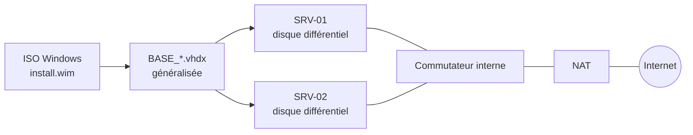

# HV-LAB Manager

HV-LAB Manager est une application de bureau Windows pour monter et faire tourner des laboratoires Microsoft Hyper-V :

- images de base ;
- machines virtuelles en disque différentiel, avec installation automatisée ;
- commutateurs virtuels et NAT.

C'est une application WinUI 3 / .NET 10 qui n'a besoin de rien d'autre sur la machine. Elle pilote Hyper-V via Windows PowerShell, donc tout ce qu'elle crée apparaît aussi dans le Gestionnaire Hyper-V.

[Télécharger la dernière version](https://github.com/JM2K69/HV-LAB/releases/latest){ .md-button .md-button--primary }
[Installation](install.md){ .md-button }

## Fonctionnalités

-   **Images de base**

    ---

    Construction d'un `BASE_*.vhdx` à partir du fichier `install.wim` ou `install.esd` d'un ISO Windows :

    - l'édition, la famille d'OS et l'index WIM sont détectés pour vous ;
    - la construction est silencieuse : aucune lettre de lecteur, aucune fenêtre de l'Explorateur ;
    - l'image reste généralisée.

    [:octicons-arrow-right-24: Images de base](guide/base-images.md)

-   **VM automatisées**

    ---

    Création d'une VM en disque différentiel, avec un `unattend.xml` injecté :

    - nom d'ordinateur et mot de passe Administrateur ;
    - langue, fuseau horaire et clé KMS ;
    - ouverture de session automatique en option.

    Le mode en lot crée `SRV-01…nn` d'un coup.

    [:octicons-arrow-right-24: Créer une VM](guide/create-vm.md)

-   **Quick VM**

    ---

    Profils de taille de XXS à XL, disque vierge ou différentiel, génération 1 ou 2, Secure Boot et démarrage PXE.

    [:octicons-arrow-right-24: Quick VM](guide/quick-vm.md)

-   **Commutateurs & NAT**

    ---

    Commutateurs externes, internes et privés, avec VLAN en option. Les réseaux NAT donnent accès à Internet aux VM d'un commutateur interne.

    [:octicons-arrow-right-24: Commutateurs & NAT](guide/networking.md)

L'interface suit le design Fluent :

- fond Mica et thème clair ou sombre ;
- français ou anglais, avec un changement de langue instantané ;
- raccourcis clavier : ++f5++ actualise et ++del++ supprime la sélection.

Toutes les opérations longues sont annulables, et toutes les saisies sont validées avant d'atteindre PowerShell.

## Démarche recommandée

Le tableau de bord propose les mêmes quatre étapes :

1. [Créer un commutateur interne](guide/networking.md#creer-un-commutateur).
2. [Configurer le NAT sur ce commutateur](guide/networking.md#reseaux-nat) pour que les VM accèdent à Internet.
3. [Construire une image de base](guide/base-images.md) à partir d'un ISO Windows.
4. [Créer des VM](guide/create-vm.md) en disque différentiel sur cette image.

Chaque VM ne stocke que ses propres modifications. Une nouvelle VM prend donc quelques secondes et quelques mégaoctets.

## Prérequis

- Windows 10/11 Pro, Entreprise ou Éducation, ou Windows Server, avec Hyper-V.
- Un compte administrateur : l'application s'exécute avec élévation.

Voir [Installation](install.md) pour le détail.
